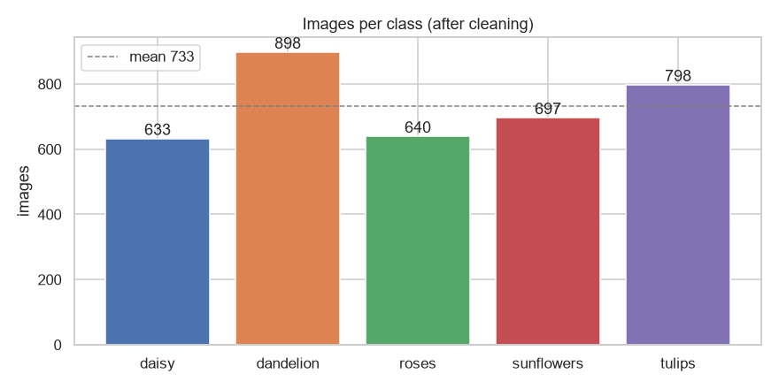
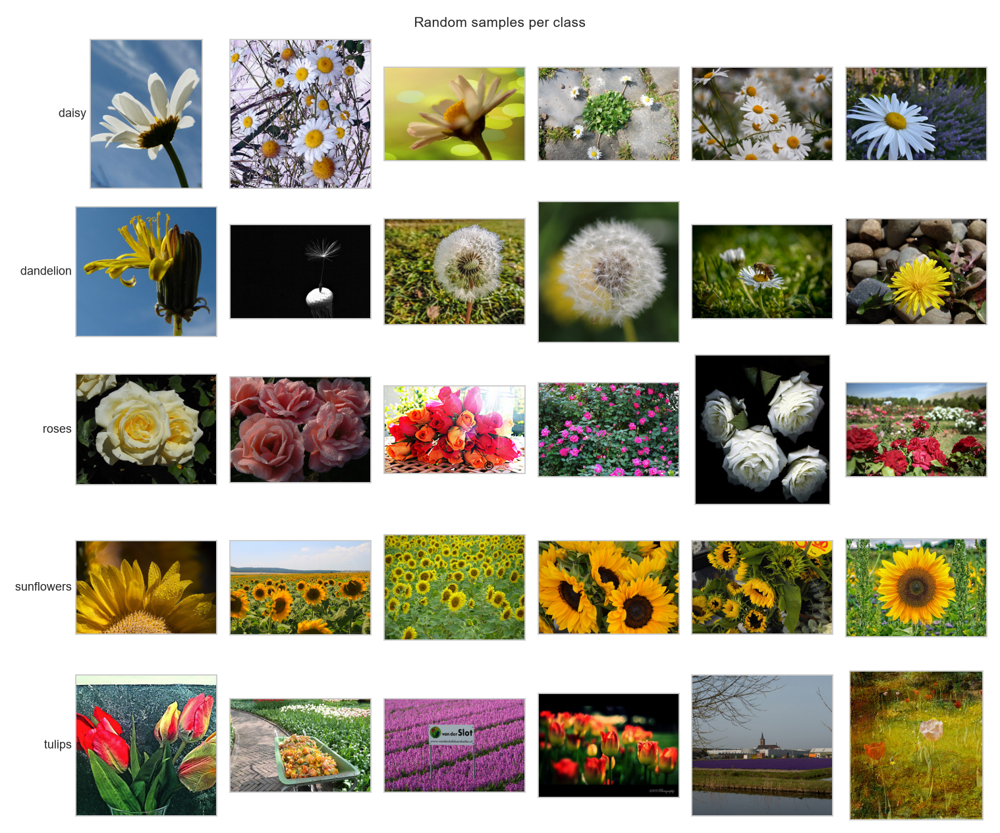
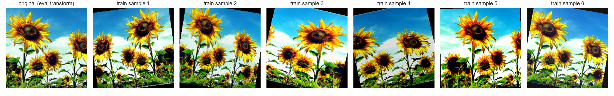
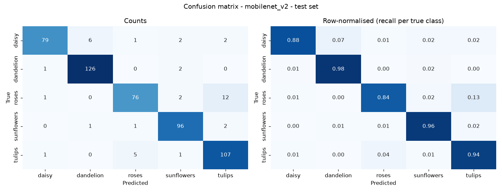
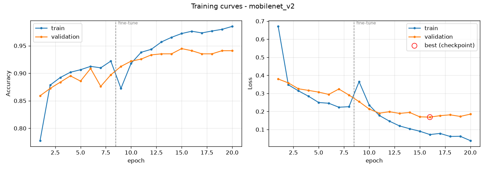
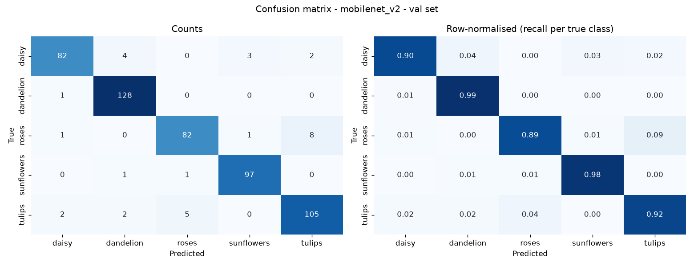
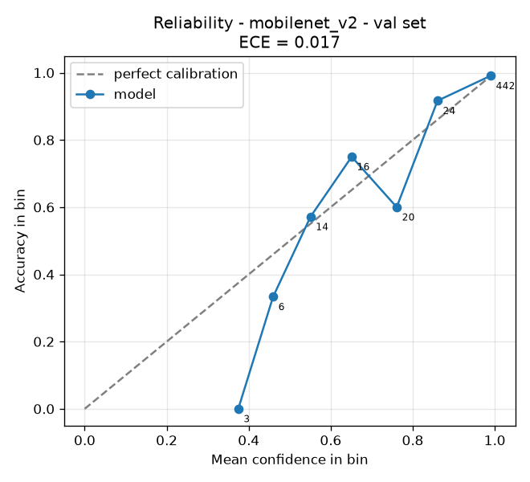
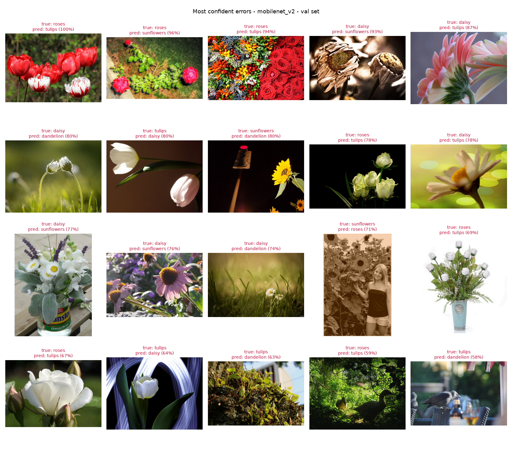

# Flower Classifier: end-to-end image classification with PyTorch

Classifies a photo as one of five flower species (**daisy, dandelion, roses, sunflowers, tulips**). The project covers every stage: integrity-checked data, a leak-free split, transfer learning on a CPU-only laptop, calibrated confidence, error analysis, and a Streamlit demo that answers *uncertain* instead of guessing.

> seKer AI & ML Internship, Project 04 (SKR-INT-CV-04)

| | |
|---|---|
| **Best model** | MobileNetV2 (ImageNet-pretrained, two-stage fine-tune) |
| **Test accuracy** (held out, evaluated once) | **92.4%** (macro F1 0.921, 524 images) |
| **Validation accuracy** | 94.1% (macro F1 0.939, 525 images) |
| **Calibration error (ECE), test** | 0.019 after temperature scaling |
| **With "uncertain" enabled** (threshold 0.60, test) | answers 94.8% of photos, **94.8%** accurate on those |
| **Hardware** | Intel i5-6300U, 2 cores, no GPU; 52 min to train |

---

## Contents

1. [Quick start](#quick-start)
2. [Dataset](#dataset)
3. [Data cleaning and splitting](#data-cleaning-and-splitting)
4. [Model and training](#model-and-training)
5. [Results](#results)
6. [Error analysis](#error-analysis)
7. [Limitations](#limitations)
8. [Project structure](#project-structure)
9. [Reproducing every experiment](#reproducing-every-experiment)
10. [Licence and attribution](#licence-and-attribution)

---

## Quick start

Tested with Python 3.14.7 on Windows 10 (CPU only). The trained MobileNetV2 checkpoint is committed, so the demo runs without training anything.

```bash
git clone <this-repo>
cd <this-repo>
python -m venv .venv
# Windows: .venv\Scripts\activate      macOS/Linux: source .venv/bin/activate
pip install -r requirements.txt

streamlit run app/streamlit_app.py
```

Then open http://localhost:8501 and upload one or more photos.

**Classify from the command line:**

```bash
python -m src.predict path/to/flower.jpg
python -m src.predict path/to/folder --csv predictions.csv
```

**From Python:**

```python
from src.predict import Predictor
p = Predictor("models/mobilenet_v2.pt")
print(p.predict_path("flower.jpg"))   # label, confidence, top-3, all probabilities
```

**With Docker** (CPU inference only):

```bash
docker build -t flower-classifier .
docker run -p 8501:8501 flower-classifier
```

### What the demo does

- Shows the predicted species, a **calibrated** confidence score and the top-3 alternatives.
- Answers **Uncertain** when the top confidence is below the threshold (default 0.60, adjustable in the sidebar). The model only knows five classes, so a photo of a cat is forced into one of them, and a low score is how that shows up.
- Shows a **Grad-CAM heatmap** of the regions that drove the prediction, so you can see whether the model looked at the flower or at the background.
- Accepts several images at once and summarises them in a table.

---

## Dataset

**[TensorFlow Flowers](https://storage.googleapis.com/download.tensorflow.org/example_images/flower_photos.tgz)** (`flower_photos`): 3,670 Flickr photos in 5 classes, released under **CC BY 2.0** with a per-image attribution in the archive's `LICENSE.txt`.

**Why this dataset:** its licence is clear, it downloads with no account or API key (so a fresh clone runs end to end), and it is small enough to fine-tune on a laptop CPU. Intel Image Classification was considered and rejected because its Kaggle licence is unclear.

| Class | Images | Share |
|---|---:|---:|
| daisy | 633 | 17.2% |
| dandelion | 898 | 24.5% |
| roses | 641 | 17.5% |
| sunflowers | 699 | 19.0% |
| tulips | 799 | 21.8% |

The imbalance is mild (largest to smallest class is 1.4 to 1), so the loss uses inverse-frequency class weights instead of resampling.



The images vary a lot: close-ups and fields, studio and outdoor shots, people and animals in frame, and sizes from tiny thumbnails to several megapixels. See [notebooks/01_eda.ipynb](notebooks/01_eda.ipynb) for the full exploration.



---

## Data cleaning and splitting

The raw images are never modified. [src/data/clean.py](src/data/clean.py) writes a manifest of the images to keep, and [reports/data_cleaning.json](reports/data_cleaning.json) records every decision.

| Check | Action | Removed |
|---|---|---:|
| Unreadable or truncated file (full decode, not only the header) | remove | 0 |
| Smaller than 64 px on either side | remove | 0 |
| Exact duplicate (MD5) filed under **two different labels** | remove all copies (label unknowable) | 2 |
| Exact duplicate, same label | keep one copy | 2 |
| Near-duplicate (perceptual hash, Hamming distance ≤ 4) | **keep, but always place in the same split** | 0 |

That leaves **3,666 images**. The scan found 15 groups of near-duplicates (30 images): the same photo resized or re-encoded. Splitting them at random could put a near-copy of a training image in the test set and inflate the score. So [src/data/split.py](src/data/split.py) uses `StratifiedGroupKFold`, which keeps class proportions and never divides a near-duplicate group. The script also asserts that no file or group appears in two splits.

| Split | Images | Purpose |
|---|---:|---|
| train | 2,617 (71%) | fitting |
| val | 525 (14%) | early stopping, calibration, model choice, error analysis |
| test | 524 (14%) | **evaluated once**, on the final model only |

All development decisions are made on the validation set. The test set is not used during development.

---

## Model and training

### Architectures

Three architectures were planned, all with identical data, augmentation, loss and schedule. Only MobileNetV2 finished training: on the CPU-only laptop the full comparison would have taken about 5 hours, so EfficientNet-B0 was stopped part-way and the custom CNN was not run (see [Results](#results)). Both are still fully implemented and run with `scripts/run_all.sh`.

| Model | Why it is here | Parameters |
|---|---|---:|
| **MobileNetV2** (ImageNet) | small and fast on CPU; a realistic deployment choice | 2.55 M |
| **EfficientNet-B0** (ImageNet) | stronger ImageNet backbone at similar cost; does it pay off on 2.6k images? | ~4.3 M |
| **Custom CNN** (from scratch, 128 px) | baseline that shows how much pretraining is worth | ~1.2 M |

### Two-stage transfer learning

1. **Head only** (8 epochs, lr 1e-3): the pretrained backbone is frozen and only the new classifier head (1280 → 256 → 5, dropout 0.3) is trained. A randomly initialised head would otherwise send large gradients into the pretrained weights and damage them.
2. **Fine-tune** (up to 15 epochs, lr 1e-4): the top 30% of backbone blocks are unfrozen, starting from the **best** head checkpoint rather than the last one. BatchNorm layers in still-frozen blocks stay in eval mode, so batches of 32 cannot overwrite their ImageNet statistics.

Both stages use AdamW (weight decay 1e-4), `ReduceLROnPlateau`, and **early stopping on validation loss** (patience 4). The saved checkpoint is always the best validation-loss epoch, never simply the last one. It is written as soon as a new best appears, so an interrupted CPU run still leaves a usable model.

### Augmentation (training only)

| Transform | Reason |
|---|---|
| `RandomResizedCrop(224, scale 0.6–1.0)` | flowers are photographed at every distance |
| `RandomHorizontalFlip` | flowers have no handedness |
| `RandomRotation(15°)` | camera tilt |
| `ColorJitter` (brightness/contrast 0.25, saturation 0.2, **hue 0.02**) | lighting varies, but hue is kept almost fixed because colour is a real cue (yellow sunflower, red rose) |

Validation, test, the CLI and the app all share one deterministic transform (resize the short side to 256, centre-crop 224, ImageNet normalisation). The preprocessing settings are **stored inside the checkpoint** and read back at inference, so training and serving cannot drift apart.



### Calibration

A model at 94% accuracy can still be over-confident, and the app's "uncertain" threshold only means something if confidence matches accuracy. [src/calibrate.py](src/calibrate.py) fits **temperature scaling** (Guo et al., 2017) on the validation set: logits are divided by one scalar T, which leaves every prediction unchanged and adjusts only the probabilities. T is saved in the checkpoint and applied automatically everywhere.

---

## Results

### Validation set (525 images)

| Model | Accuracy | Macro F1 | ECE | Train time (CPU) |
|---|---:|---:|---:|---:|
| **MobileNetV2** | **0.941** | **0.939** | 0.017 | 52 min |
| EfficientNet-B0 | *stopped* | | | |
| Custom CNN (scratch) | *not run* | | | |

**EfficientNet-B0** was stopped after 9 of up to 23 epochs to save CPU time. With the backbone still frozen it reached 93.1% validation accuracy (epoch 6), against 90.9% for MobileNetV2 at the same stage. That suggests it could match or beat MobileNetV2 after fine-tuning, but the run is incomplete, so it is **not** reported as a result and its checkpoint is not committed. Finishing this comparison, plus the from-scratch baseline, is the first item of future work and takes minutes on a GPU.

### Test set (524 images, evaluated once)

MobileNetV2 was the only fully trained model, so it is the final model. It was evaluated on the test set exactly once, after all development decisions were made.

| Model | Accuracy | Macro F1 | ECE | Coverage @ 0.60 | Accuracy when confident |
|---|---:|---:|---:|---:|---:|
| **MobileNetV2** | **0.924** | **0.921** | 0.019 | 94.8% | 94.8% |

| Class | Precision | Recall | F1 | Support |
|---|---:|---:|---:|---:|
| daisy | 0.963 | 0.878 | 0.919 | 90 |
| dandelion | 0.947 | 0.977 | 0.962 | 129 |
| roses | 0.916 | 0.835 | 0.874 | 91 |
| sunflowers | 0.932 | 0.960 | 0.946 | 100 |
| tulips | 0.870 | 0.939 | 0.903 | 114 |

Test accuracy is **1.7 points below validation** (92.4% vs 94.1%). A small gap is expected, because the validation set chose the checkpoint (early stopping) and fitted the temperature, which makes validation scores slightly optimistic. The gap is also within sampling noise: with 524 images, the 95% confidence interval on test accuracy is about ±2.3 points. The error pattern repeats: **roses predicted as tulips is again the largest error (12 of 40)**, followed by daisies predicted as dandelions (6).



### MobileNetV2 in detail (validation)

| Class | Precision | Recall | F1 | Support |
|---|---:|---:|---:|---:|
| daisy | 0.953 | 0.901 | 0.927 | 91 |
| dandelion | 0.948 | 0.992 | 0.970 | 129 |
| roses | 0.932 | 0.891 | 0.911 | 92 |
| sunflowers | 0.960 | 0.980 | 0.970 | 99 |
| tulips | 0.913 | 0.921 | 0.917 | 114 |
| **macro avg** | **0.941** | **0.937** | **0.939** | 525 |

**Training curves.** The head stage reaches ~90% validation accuracy with the backbone frozen. Unfreezing adds about 4 points. Early stopping ended the run at epoch 20 and kept epoch 16 (lowest validation loss, 0.169). By the end, training accuracy (98.5%) is well above validation accuracy (94%). That is mild overfitting, which early stopping stopped at the right point.



**Confusion matrix.** Most errors are **roses and tulips mistaken for each other**: 8 roses predicted as tulips, 5 tulips as roses. Both are cup-shaped flowers in the same colours (red, pink, white, yellow), and at 224 px the petal structure that tells them apart is partly lost. Dandelion and sunflowers are the easiest classes, since both are yellow with a very distinctive shape.



**Calibration.** The model was already well calibrated before scaling (ECE 0.018, T = 1.30). Temperature scaling softened its confidence slightly (ECE 0.017). Both numbers come from the same validation set that T was fitted on, so they are slightly optimistic. The test-set ECE is the honest figure.



**The uncertainty threshold** at 0.60 sets aside 4.4% of validation images as *uncertain*. Accuracy on the remaining 95.6% rises from 94.1% to 96.4%. You can move the slider in the app to trade coverage for accuracy.

---

## Error analysis

Here are the 20 validation errors the model was **most confident** about. These matter most, because a confident mistake is what a user would trust.



Reading them one by one, the 31 errors fall into four groups:

1. **Wrong labels in the dataset.** The model's most confident "mistake" (100%) is a photo of red and white tulips **filed under roses**. The model is right and the label is wrong. Several "daisy" photos actually show other members of the daisy family, such as gerbera and purple coneflower (*Echinacea*). Their large central disc looks like a sunflower, which explains the daisy→sunflowers errors. Real-world data has noisy labels, so part of the remaining 6% cannot be removed by a better model.
2. **The flower is not the subject.** A duck in undergrowth, a crow on a café chair, a patch of rocks and moss, and a sepia portrait taken in a sunflower field. With no clear flower to look at, the model guesses from colour and texture.
3. **Colour removed.** White roses and white tulips are confused in both directions. Without colour, only the petal shape is left, and that is subtle at 224 px.
4. **Tiny or out-of-focus subject.** Small daisies in a blurred meadow are predicted as dandelions. The flower covers only a few dozen pixels after the centre crop.

**What this suggests:**
- Better labels would help more than a bigger model. `src/data/clean.py` already accepts a `data/exclusions.csv` list of confirmed bad labels. It was **not** filled from these validation errors, because removing only the examples the model gets wrong would inflate the validation score.
- Higher input resolution (e.g. 320 px) would help the rose/tulip and small-subject cases, at roughly double the CPU cost.
- An "uncertain" answer is the right behaviour for groups 2 and 4, and the threshold already catches some of them.

---

## Limitations

- **Closed set.** The model only knows five species. Any other flower, or any photo at all, gets mapped to one of the five. The uncertainty threshold reduces this risk but does not solve it, because a confident wrong answer is still possible on images unlike the training data.
- **Dataset bias.** These are Flickr photos from about 2010, mostly well lit and centred. Phone photos at odd angles, at night or through glass may score lower than the numbers above.
- **Noisy labels.** As shown above, the dataset itself contains mislabelled images, so accuracy has a ceiling below 100% no matter the model.
- **Small evaluation sets.** With about 525 images per split, one image is 0.19 percentage points and the 95% confidence interval on accuracy is about ±2 points.
- **CPU-only training.** Only one architecture was trained to completion, with a single seed and no hyperparameter search. The planned EfficientNet-B0 and from-scratch comparisons are implemented but not yet run in full.

---

## Project structure

```
├── app/streamlit_app.py       Streamlit demo (prediction, uncertainty, Grad-CAM, batch upload)
├── config.yaml                every path and hyperparameter, in one place
├── src/
│   ├── data/
│   │   ├── download.py        fetch + safely extract the archive
│   │   ├── clean.py           integrity scan, duplicate removal, near-duplicate grouping
│   │   ├── split.py           stratified, group-aware train/val/test split
│   │   └── dataset.py         PyTorch Dataset + train/eval transforms
│   ├── models.py              MobileNetV2, EfficientNet-B0, custom CNN
│   ├── train.py               two-stage training, early stopping, checkpointing
│   ├── calibrate.py           temperature scaling
│   ├── evaluate.py            metrics, confusion matrix, reliability diagram, error gallery
│   ├── predict.py             Predictor class + CLI
│   └── gradcam.py             Grad-CAM heatmaps
├── notebooks/01_eda.ipynb     exploratory data analysis
├── models/                    trained checkpoints (see models/README.md)
├── reports/
│   ├── figures/               every figure in this README
│   ├── eval/<run>_<split>/    metrics.json, predictions.csv, classification report
│   ├── runs/<run>/            per-epoch training history
│   └── *.json                 dataset, cleaning and split summaries
├── scripts/run_all.sh         reproduces every experiment
├── Dockerfile                 serves the demo
└── requirements.txt           pinned dependencies
```

---

## Reproducing every experiment

```bash
bash scripts/run_all.sh
```

This downloads the data, cleans it, splits it, trains all three models, then calibrates and evaluates each on the validation set. It takes about 3–4 hours on a dual-core CPU and minutes on a GPU, which is used automatically if present. Each step can also run on its own:

```bash
python -m src.data.download
python -m src.data.clean
python -m src.data.split
python -m src.train --arch mobilenet_v2           # or efficientnet_b0, or: custom_cnn --image-size 128
python -m src.calibrate --model models/mobilenet_v2.pt
python -m src.evaluate  --model models/mobilenet_v2.pt --split val
python -m src.evaluate  --model models/mobilenet_v2.pt --split test   # once, on the final model
```

Everything is seeded (`seed: 42` in `config.yaml`). A re-run on the same machine reproduced the original training run epoch for epoch. Results on other hardware may differ slightly because of non-deterministic CPU/GPU kernels.

---

## Licence and attribution

- **Code:** written for the seKer AI internship.
- **Dataset:** TensorFlow Flowers, © the individual Flickr photographers, licensed under [CC BY 2.0](https://creativecommons.org/licenses/by/2.0/). Per-image credits are in `data/raw/flower_photos/LICENSE.txt` after download. Images are not redistributed in this repository.
- **Pretrained weights:** torchvision ImageNet weights for MobileNetV2 and EfficientNet-B0.
- **Method references:** Sandler et al., *MobileNetV2* (2018); Tan & Le, *EfficientNet* (2019); Guo et al., *On Calibration of Modern Neural Networks* (2017); Selvaraju et al., *Grad-CAM* (2017).
